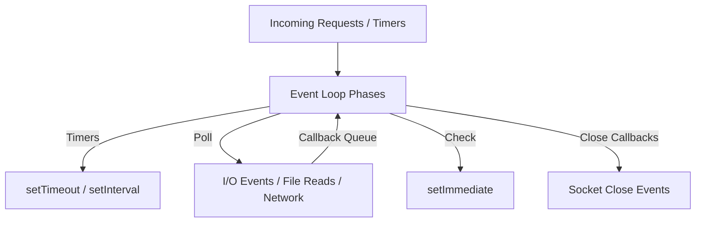

# Asynchronous & Event-Driven Architecture

- **Topic:** Node.js

- **Instructor: RAHUL KP**

## 1. Callbacks Concept (Blocking vs Non-Blocking Code)

Asynchronous programming lies at the heart of Node.js performance.

### Blocking (Synchronous) Code Example

Execution halts until the file operation finishes, blocking the main thread.

```javascript
const fs = require("fs");

// Blocking I/O blocks subsequent code execution
const data = fs.readFileSync("/path/to/file.txt", "utf8");
console.log(data);
console.log("Execution continues after file read completes.");
```

### Non-Blocking (Asynchronous) Code Example

Execution continues immediately; the callback function handles the response once the operation completes.

```javascript
const fs = require("fs");

// Non-blocking I/O using callbacks
fs.readFile("/path/to/file.txt", "utf8", (err, data) => {
  if (err) throw err;
  console.log(data);
});

console.log("Execution continues immediately without waiting for file read!");
```

---

## 2. Events & Event Loop Mechanisms

The **Event Loop** is what allows Node.js to perform non-blocking I/O operations by offloading operations to the system kernel whenever possible.



---

## 3. Event Emitter & Debugger

The `events` module enables communication between decoupled components using custom events.

### Event Emitter Example

```javascript
const EventEmitter = require("events");
const myEmitter = new EventEmitter();

// Register an event listener
myEmitter.on("userLoggedIn", (username) => {
  console.log(`User session started for: ${username}`);
});

// Trigger the event
myEmitter.emit("userLoggedIn", "Rahul KP");
```

### Node.js Debugger

Node.js comes with a built-in debugging utility. Start your application in debug mode:

```bash
node inspect app.js

```

You can place breakpoints using `debugger;` statements inside your JavaScript source code and navigate execution using commands like `cont` (c), `next` (n), and `step` (s).
