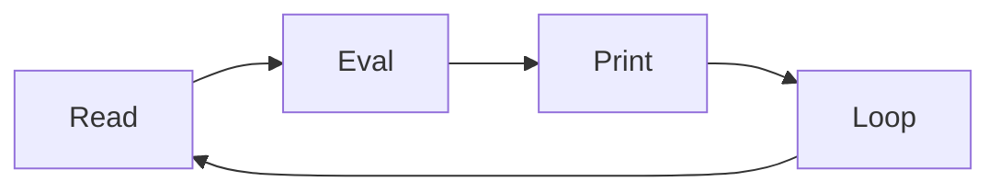

# Core Concepts & CLI Tools

- **Topic:** Core Concepts & CLI Tools

- **Instructor: RAHUL KP**

## 1. Console Applications & Application Entry Point

Node.js applications typically execute a designated entry point file (e.g., `app.js` or `server.js`). A basic console application reads standard inputs or outputs logs to the terminal using the global `console` object.

```javascript
// app.js - Application Entry Point
console.log("Starting Node.js Console Application...");

const args = process.argv.slice(2);
const userName = args[0] || "Developer";

console.log(`Hello, ${userName}! Welcome to Node.js backend engineering.`);
```

Execution via CLI:

```bash
node app.js Rahul

```

---

## 2. REPL Terminal Tools & Command Line Options

The **REPL** (Read-Eval-Print-Loop) environment provides an interactive shell for testing JavaScript expressions instantly.



### REPL Special Commands & Features

- **Multiline Expression:** Wrap statements across multiple lines by pressing `Enter`; Node.js automatically detects open braces or brackets.
- **Underscore Variable (`_`):** Represents the result of the last evaluated expression.
- **Dot Commands:**
- `.help` — Lists all REPL commands.
- `.save filename` — Saves all evaluated REPL sessions to a file.
- `.load filename` — Loads a file into the current REPL session.
- `.exit` — Exits the REPL session.

### Command Line Options (`node [options] [script.js]`)

- `-v`, `--version`: Prints the installed Node.js version.
- `-e`, `--eval "script"`: Evaluates the provided string as JavaScript.
- `-p`, `--print`: Evaluates the script and prints the result.
- `--inspect`: Enables V8 inspector for debugging.

---

## 3. Package Manager (NPM)

NPM is the default package manager for Node.js, used for installing, updating, and managing third-party libraries.

### Package Operations

- **Local Installation (Project Scope):** Installs packages inside the local `node_modules` directory and updates `package.json`.

```bash
npm install express

```

- **Global Installation (System Scope):** Installs packages globally to be executed as system-wide command-line utilities.

```bash
npm install -g nodemon

```

- **Updating Packages:** Checks and upgrades packages to newer versions.

```bash
npm update express

```

- **Uninstalling Packages:** Removes a package and updates dependency configurations.

```bash
npm uninstall express
```
