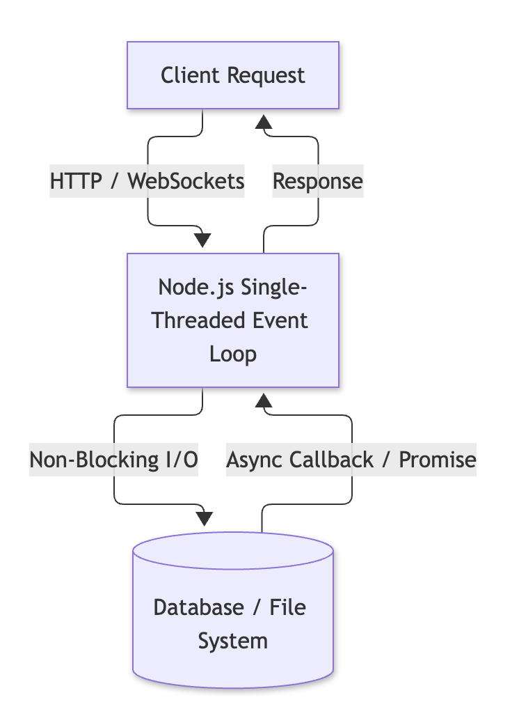

# Node.js, Introduction & Environment Setup

- **Topic:** Node.js, Introduction & Environment Setup

- **Instructor: RAHUL KP**

## 1. Overview, Features & Applications

Node.js is an open-source, cross-platform JavaScript runtime environment built on Chrome's V8 JavaScript engine. It allows developers to execute JavaScript code outside the browser, primarily for server-side development.



### Core Features

- **Asynchronous and Event-Driven:** All APIs of Node.js library are asynchronous (i.e., non-blocking), ensuring high performance and speed.
- **Single-Threaded with Event Loop:** Uses a single-threaded model with event looping to handle multiple concurrent clients efficiently without creating new threads for each request.
- **V8 Engine Performance:** Compiles JavaScript directly into native machine code using Google's V8 engine.
- **No Buffering:** Applications simply output data in chunks.
- **Cross-Platform Support:** Runs seamlessly across Windows, macOS, and Linux.

### Key Applications

- **REST APIs & Microservices:** Building fast, scalable network applications and backend services.
- **Real-Time Chat & Collaboration Apps:** Utilizing WebSockets for instant, bi-directional communication.
- **Streaming Applications:** Handling heavy media streaming and data pipelines efficiently.
- **Command Line Tools (CLIs):** Automating workflows and managing development tasks.

---

## 2. Local Setup (Windows / Ubuntu Linux)

### Installation on Windows

1. Visit the official [Node.js Website](https://nodejs.org/) and download the **LTS (Long Term Support)** installer (`.msi`).
2. Run the installer, accept the license terms, and select the installation directory.
3. Ensure the **"Add to PATH"** option is enabled during installation.
4. Verify the installation in your terminal (`cmd` or PowerShell):

```bash
node -v
npm -v

```

### Installation on Ubuntu Linux

1. Update your package index and install via NodeSource or apt:

```bash
sudo apt update
sudo apt install curl
curl -fsSL [https://deb.nodesource.com/setup_lts.x](https://deb.nodesource.com/setup_lts.x) | sudo -E bash -
sudo apt install -y nodejs

```

2. Verify the installation:

```bash
node -v
npm -v
```
